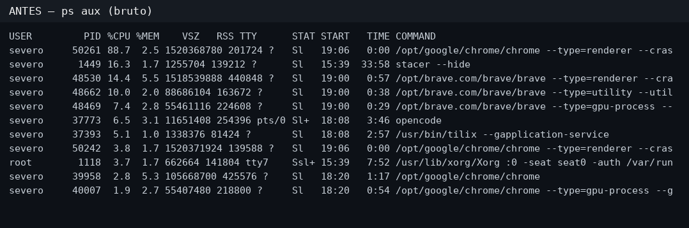

# 🌶️ Zest — o tempero do seu terminal

      

**Zsh** produtivo, legível para humanos e instalável em **qualquer distro Linux** — sem precisar de root.

> EN: Zest turns any Linux terminal into a productive, human-friendly shell. No root required. [Install ↓](#-instalação)

## Por quê?

O terminal Linux padrão é cru e as mensagens de erro parecem latim. O Zest acrescenta o **tempero**: aliasing inteligente, funções que falam português, barras gráficas, e ferramentas modernas — **sem remover nada** do que você já tem.

| Antes | Com Zest |
|---|---|
| `ps aux` ilegível | `topmem` → `firefox-esr 3,4 GB █████████░░░ 45%` |
| `df -h` com colunas crípticas | `df` → barras coloridas (duf) |
| `fatal: not a git repository` | `❌ Esta pasta não é um projeto git — dicas do que fazer` |
| 12 gerenciadores de pacote um por um | `updateall` → atualiza tudo, pula o que não existe |
| Anotações em post-its | `note` → nota rápida no terminal, `notes` numeradas, `noterm 3` |



*`topmem`: o mesmo `ps aux` acima, agrupado por programa e com barras — gerado direto do Zest, sem edição.*

## ✨ Princípios

1. **Zero root por padrão** — ferramentas vão para `~/.local/bin`
2. **Aditivo, nunca destrutivo** — o `.zshrc` recebe só um bloco marcado; backup automático
3. **Idempotente** — rodar o instalador 2x dá o mesmo resultado
4. **Tudo opcional** — sem fzf? Sem Oh My Zsh? Os módulos pulam o que não existir
5. **Reversível** — `uninstall.sh` sai limpo

## 📦 Instalação

**Você não precisa instalar dependências manualmente** — o instalador detecta o que falta (zsh, git, curl, python3) e instala sozinho, pedindo a senha do `sudo` (ou do `root` em Debian recém-instalado). Funciona com apt, dnf, pacman, zypper e apk.

Numa máquina zerada, baixe e rode (o `wget` já vem no Debian):

```bash
wget -qO- https://github.com/reginaldosevero/zest/archive/refs/heads/master.tar.gz | tar xz
cd zest-master && bash install.sh --with-omz
```

Ou, se já tem git:

```bash
git clone https://github.com/reginaldosevero/zest ~/projetos/zest
cd ~/projetos/zest
./install.sh --with-omz   # ou o sabor da tabela abaixo
```

Escolha o seu sabor — os módulos do Zest funcionam **com ou sem framework**:

| Você tem/quer | Comando |
|---|---|
| Zest puro (zsh puro, sem plugins extra) | `./install.sh` |
| Zest + plugins standalone (sem Oh My Zsh) | `./install.sh --with-plugins` |
| Zest + Oh My Zsh + plugins (instala o omz se faltar) | `./install.sh --with-omz` |
| Já usa zinit, antidote ou outro framework? | `./install.sh --with-plugins` — os plugins são scripts soltos, carregam em qualquer um |

Depois:

```bash
source ~/.zshrc
zest doctor                 # diagnostica o ambiente
zest add fzf bat eza ripgrep fd delta lazygit duf jq yq direnv tldr zoxide atuin mise
```

## 🧰 Comandos que o Zest traz

> **Não sabe por onde começar?** Digite `ajuda` em qualquer terminal. Sai uma colinha com tudo que o Zest oferece, organizada por categoria. Aceita filtro: `ajuda git`, `ajuda histórico`, `ajuda nota`.

**Diagnóstico:** `sysinfo` · `topmem` · `topcpu` · `df` · `portcheck host porta` · `ipinfo`

**Produtividade:** `note` / `notes` / `noterm N` / `noteclean` · `todo` / `todos` / `tododone` · `calc 2+2` · `timer 25` · `worldtime` · `weather` · `news` (em português!)

**Git:** `git status` com mensagem amigável fora de repositórios · `glog` · `gpull` · `gstash "msg"` · `gclean_branches` · `lazygit`

**Arquivos:** `z` (cd inteligente) · `ll` · `lt` · `bat` · `fd` · `rg` · `extract arquivo.zip` · `syncdir origem destino` · `backup_dir pasta`

**Manutenção:** `updateall` (12 gerenciadores: apt, omz, mise, uv, pipx, pip, flatpak, snap, npm, rustup, opencode, tldr) · `sysclean` · `fuck` (corrige typos)

**Projetos em segundos:** `pyproject minha-api` · `nodeproject meu-site` · `goproject` · `rustproject`

**Histórico do shell:** `histnum` (lista numerada) · `histsed N` (apaga uma linha) · `histdel 'senha'` (apaga todas com o padrão) · `histclear` (apaga tudo) · `histsearch` · `histcount` · `histclean` (remove duplicatas)

**Novo ✨ Ortografia:** `spell` (novo!) · `correct` · `spell arquivo` · `spell -` · `spell -x` — veja a seção **spell — corretor ortográfico** logo abaixo

## ✅ spell — corretor ortográfico (novo!)

Função **nova do Zest**: verifica ortografia de qualquer texto em português com o [aspell](http://aspell.net) (dicionário `pt_BR` ativado automaticamente quando instalado).

```bash
spell readme.txt      # verifica um arquivo: lista cada erro com sugestões
spell -               # verifica o que você digita (Ctrl+D no fim) — ou use pipe:
echo "este texo tem exeplario" | spell -
spell -x              # verifica o texto que você COPIOU (Ctrl+C em qualquer lugar)
spell -i readme.txt   # interativo: corrige palavra por palavra
```

Saída real:

```
❌ texo
   → teixo, texto, teco, taxo, teio, mexo, nexo, sexo

📝 1 palavra(s) com problema em readme.txt
   para corrigir uma a uma: spell -i readme.txt
```

> **`correct`** — comando extra que ativa a correção de **comandos** nativa do zsh:
> você digita `git stautos` e o zsh pergunta se era `git status`.

## 🗂️ Estrutura

```
zest/
├── install.sh · uninstall.sh    # entram e saem limpos
├── bin/zest                     # CLI: doctor · update · add
├── modules/*.zsh                # um módulo por tema, todos com guardas
│   ├── 00-path · 05-safety · 20-tools · 21-keys
│   ├── 30-aliases · 41-daily · 43-git · 45-devops
│   ├── 46-system · 47-projects · 48-text · 49-utils · 50-history
│   └── 98-ajuda · 99-welcome
├── lib/install-tool.sh          # baixa binários certos por distro/arquitetura
└── tests/smoke.sh               # CI-ready
```

## 🧹 Desinstalação

O Zest sai limpo: basta rodar `uninstall.sh` no diretório do projeto.

**Modo padrão** (seguro — só remove o Zest, mantém seu setup):

```bash
git clone https://github.com/reginaldosevero/zest
cd zest
bash uninstall.sh
```

Remove:
- bloco `>>> zest >>>` do `.zshrc`
- módulos em `~/.config/zest/`
- comando `~/.local/bin/zest`

Mantém (intencional):
- ferramentas CLI instaladas via `zest add` (bat, fzf, rg…)
- backups `.zshrc.zest-bak-*`
- Oh My Zsh (se estiver instalado)

**Modo completo** (remove TUDO que o Zest criou):

```bash
bash uninstall.sh --full
```

Além do modo padrão, remove também:
- `~/.oh-my-zsh/` (instalado pelo Zest)
- backups `.zshrc.zest-bak-*`
- cache de completion `.zcompdump-*`

Em ambos os casos, as ferramentas CLI em `~/.local/bin` ficam — se quiser apagá-las também:

```bash
rm -f ~/.local/bin/{fzf,zoxide,atuin,mise,jq,yq,direnv,eza,rg,fd,bat,delta,lazygit,duf,tldr}
```

---

## 🗺️ Roadmap

- [x] **v0.1** — módulos funcionais + install/uninstall + doctor + smoke test
- [x] **CI em Debian/Fedora/Arch/Alpine** — instalar → reinstalar → doctor → desinstalar (v0.1.7)
- [ ] **v0.2** — detecção de distro no install-tool (apt/dnf/pacman antes de binário)
- [ ] **v1.0** — i18n (pt_BR/en) · `curl | bash`

## 📄 Licença

MIT — veja [LICENSE](LICENSE).

## 💸 Apoie o Zest

O Zest é gratuito e sempre será. Se ele te ajudou, uma doação espontânea é sempre bem-vinda:

**⚡ Lightning Network** (instantâneo, taxas mínimas):
```
nados@speed.app
```

**₿ Bitcoin (on-chain)**:
```
bc1qyxsu8mhgujqau8e87lthgxg08eq0qw0426du5z
```

> EN: Zest is free forever. If it helped you, Bitcoin donations are welcome — Lightning or on-chain (addresses above). Obrigado / Thank you! 🌶️

## 🆘 Problemas comuns (VM / máquina nova)

| Sintoma | Causa | Solução |
|---|---|---|
| `command not found: git` ao clonar | git não instalado | `su -c 'apt install -y git'` |
| O instalador diz `❌ Pré-requisitos faltando: zsh…` | zsh não instalado | `sudo apt install -y zsh` ou `su -c 'apt install -y zsh'` |
| `zest add` falha em tudo | falta `curl`/`wget` | `sudo apt install -y curl` |
| `./install.sh: Permission denied` | baixou o ZIP (perde o +x) | `bash install.sh --with-omz` |
| `✗ sintaxe` no `tests/smoke.sh` | **não rode o smoke como usuário** — é teste de desenvolvimento e exige zsh instalado | apenas rode `./install.sh` |

O instalador diagnostica tudo sozinho: se algo faltar, ele diz **o quê** e **o comando exato** (com `sudo` ou `su`) para resolver.

## 🙏 Créditos

O Zest não reinventa a roda — ele é o maestro de uma orquestra de projetos brilhantes:

- **[Oh My Zsh](https://github.com/ohmyzsh/ohmyzsh)** (MIT) — de Robby Russell e da comunidade. Inspiração direta dos aliases de git do Zest e do ecossistema de plugins. Opcional: o Zest funciona com ele ou sem ele.
- **Plugins zsh** (baixados pelo instalador, cada um com sua licença):
  - [zsh-autosuggestions](https://github.com/zsh-users/zsh-autosuggestions) · [zsh-syntax-highlighting](https://github.com/zsh-users/zsh-syntax-highlighting) · [zsh-completions](https://github.com/zsh-users/zsh-completions) · [zsh-history-substring-search](https://github.com/zsh-users/zsh-history-substring-search) — time **zsh-users**
  - [zsh-autopair](https://github.com/hlissner/zsh-autopair) — hlissner
- **Ferramentas CLI** que o `zest add` baixa (apenas automatiza o download; cada uma mantém sua licença):
  - fzf (junegunn) · ripgrep (BurntSushi) · fd e bat (sharkdp) · eza (eza-community) · delta (dandavison) · lazygit (jesseduffield) · duf (muesli) · jq (jqlang) · yq (mikefarah) · direnv (direnv) · tealdeer (tealdeer-rs) · zoxide (ajeetdsouza) · atuin (ellie) · mise (jdx) · thefuck (nvbn)

Muito obrigado a todas essas pessoas. 🌶️
